<p align="center">
  
</p>

<p align="center">
  <a href="mailto:YOUR_EMAIL"></a>
  <a href="https://linkedin.com/in/YOUR_LINKEDIN"></a>
  <a href="https://scholar.google.com/citations?user=YOUR_ID"></a>
  <a href="https://orcid.org/YOUR_ORCID"></a>
  <a href="https://app.hackthebox.com/profile/YOUR_HTB"></a>
</p>

<br/>

<table>
<tr>
<td width="58%" valign="top">

#### About

I'm a doctoral researcher at **ENSMR** (École Nationale Supérieure des Mines de Rabat). My work sits where software, infrastructure and security meet. I build systems, deploy and operate them, and then try to break them.

Most of what's here is research code, infrastructure tooling, security labs and production web work.

</td>
<td width="42%" valign="top">

#### Now

```yaml
research:  YOUR RESEARCH TOPIC
security:  web app testing, hardening
infra:     containers, CI/CD, IaC
location:  Morocco
languages: EN · FR · AR
```

</td>
</tr>
</table>

<br/>

### `01` &nbsp;Research

Doctoral research at ENSMR on **YOUR RESEARCH TOPIC**. Write one or two sentences on the problem and the approach.

| Year | Title | Venue | |
|:----:|-------|-------|:-:|
| 2026 | *Paper title* | Conference / Journal | [pdf](#) |
| 2025 | *Paper title* | Conference / Journal | [pdf](#) |

<br/>

### `02` &nbsp;Security

Web application testing, network and traffic analysis, Linux hardening, CTFs.

<p>
  
  
  
  
  
  
  
</p>

<br/>

### `03` &nbsp;DevOps & Infrastructure

<p>
  
  
  
  
  
  
  
  
  
  
  
</p>

<br/>

### `04` &nbsp;Development

<p>
  
  
  
  
  
  
  
  
  
  
</p>

<br/>

### `05` &nbsp;Selected work

| Project | What it does | Area |
|---------|--------------|:----:|
| [**REPO_1**](https://github.com/aimdexter/REPO_1) | One concrete line: the problem and the result | `security` |
| [**REPO_2**](https://github.com/aimdexter/REPO_2) | One concrete line | `devops` |
| [**REPO_3**](https://github.com/aimdexter/REPO_3) | One concrete line | `research` |
| [**REPO_4**](https://github.com/aimdexter/REPO_4) | One concrete line | `dev` |

<br/>

### `06` &nbsp;Activity

<p align="center">
  <picture>
    <source media="(prefers-color-scheme: dark)" srcset="https://raw.githubusercontent.com/aimdexter/aimdexter/output-3d-contrib/profile-3d-contrib/profile-night-view.svg" />
    
  </picture>
</p>

<p align="center">
  
  
</p>

<br/>

<p align="center">
  <sub><code>PGP YOUR_FINGERPRINT</code> &nbsp;·&nbsp; responsible disclosure welcome</sub>
</p>
